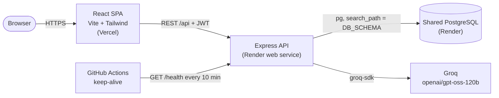
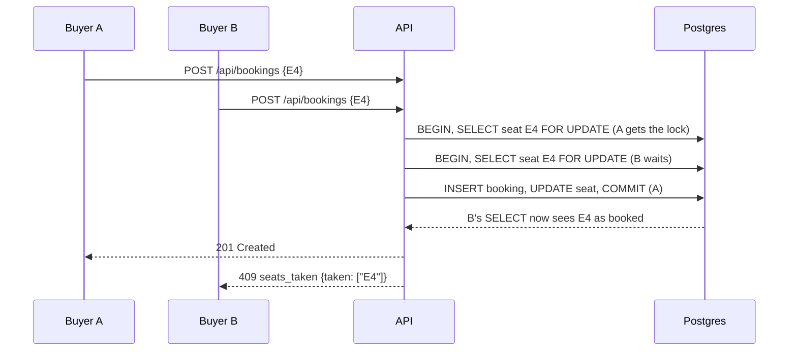

# CineVerse

**Book movie tickets the way a real cinema works: live seat maps, tiered pricing, QR tickets, and seat locking that is safe even when two people grab the same seat at once.**

[](https://github.com/HarshBathija-04/Movie-booking-system/actions/workflows/ci.yml)


| | |
| --- | --- |
| **Live app** | `https://<your-app>.vercel.app` |
| **API health** | `https://<your-api>.onrender.com/health` |
| **Demo login** | `demo@cineverse.app` / `demo1234`, or click **Continue with the demo account** |

> The API is on Render's free tier and sleeps when idle, so the first request can take 30 to 60 seconds. The UI shows a "waking up the server" notice while it starts.

## Features

- **Live seat map** with Regular, Premium and Recliner tiers. The server sets every price. Arrow keys move around the map and screen readers get a label for each seat.
- **Safe checkout.** Seats are row-locked inside one transaction. When two buyers race for a seat, one gets it and the other sees which seats were taken. The map then refreshes.
- **Showtimes by day** with format (2D / 3D / IMAX), "from" price and how many seats are left.
- **Ticket wallet** with upcoming and past bookings, each with a QR code and a print-friendly ticket.
- **AI concierge (Groq).** Describe your mood and get up to three picks from films that are actually playing. Picks that don't match a real film are dropped.
- **Admin console** (lazy-loaded) with revenue and ticket stats, film management with soft delete, scheduling, and booking search.

## Screenshots

| Home | Seat map |
| --- | --- |
|  |  |
| **Film and showtimes** | **QR ticket** |
|  |  |

<p align="center"></p>

## Architecture



What happens when two buyers want seat E4:



## Engineering highlights

- **Transaction-safe bookings.** `reserveSeats` locks the requested seat rows with `SELECT ... FOR UPDATE`, checks them, writes the booking and claims the seats in one transaction. The `UPDATE` also requires `booking_id IS NULL`, as a second guard. A test fires 8 concurrent buyers at one seat and checks that exactly one wins.
- **Schema-per-app on a shared database.** Several portfolio apps share one free Render Postgres. Each app keeps its tables in its own schema (`DB_SCHEMA`, validated as a plain SQL identifier). The pool pins `search_path`, so the SQL never mentions the schema.
- **Self-maintaining demo data.** Migrations and an idempotent seed run on every boot. A Postgres advisory lock stops two instances from migrating at once. The seed keeps the schedule four days ahead, deletes stale shows, and uses a seeded random generator so the "sold" seats stay the same each time.
- **Prices are set only on the server.** Tier multipliers live in `server/utils/pricing.js`. The client only shows the prices the API returns and sends seat numbers, never amounts.
- **The AI never makes up films.** The model gets only bookable films and must reply in JSON. `parsePicks` drops unknown ids and duplicates and caps the text length, so the UI never shows a film that isn't playing.
- **Cinema time zone.** Showtimes are stored as `timestamptz` and formatted in IST by Postgres, so every visitor sees the cinema's local time wherever they are.
- **Hardening at the edges.** Every route validates input with zod. The API also uses helmet, a CORS allow-list, rate limits on auth and AI, and one JSON error shape everywhere. Roles never come from the request, and `/health` checks the database too.

## Tech stack

| Layer | Tech |
| --- | --- |
| Frontend | React 19, React Router 7, Vite 8, Tailwind CSS 4, axios, lucide-react, react-hot-toast |
| Backend | Node 22+, Express 5, pg, zod, helmet, express-rate-limit, jsonwebtoken, bcryptjs, qrcode, nodemailer (optional) |
| AI | Groq via `groq-sdk` (`openai/gpt-oss-120b`), called only by the backend |
| Data | PostgreSQL 16, plain SQL migrations, idempotent seed |
| Quality | Vitest + Supertest (with a concurrent double-booking test), ESLint, Prettier, GitHub Actions |
| Hosting | Vercel (web), Render (API), shared Render PostgreSQL |

## Quick start

You need Node 22+ and PostgreSQL. Docker works fine for the database.

```bash
# 1. Database (skip if you already have Postgres)
docker run -d --name cineverse-pg -e POSTGRES_PASSWORD=postgres -e POSTGRES_DB=portfolio -p 5433:5432 postgres:16-alpine

# 2. API on http://localhost:5126
cd server
cp .env.example .env      # add GROQ_API_KEY to turn on the AI concierge
npm install
npm run db:migrate
npm run db:seed
npm run dev

# 3. Web on http://localhost:5213 (in a second terminal)
cd client
cp .env.example .env
npm install
npm run dev
```

Open http://localhost:5213 and sign in with the demo account. To use the admin console, set `ADMIN_EMAIL` and `ADMIN_PASSWORD` in `server/.env` and run `npm run db:seed` again.

**Checks.** Run `npm run lint`, `npm run format:check` and `npm test` in each package, and `npm run build` in `client/`. The server tests need the database. They reset a separate `movie_booking_test` schema on every run (change it with `TEST_DB_SCHEMA`).

## Environment variables

**`server/.env`**

| Variable | Required | Description |
| --- | --- | --- |
| `DATABASE_URL` | yes | Postgres connection string. On Render, the shared database's Internal Database URL |
| `DB_SCHEMA` | no, default `movie_booking` | Schema for this app's tables in the shared database |
| `JWT_SECRET` | in production | Secret for signing auth tokens. The Blueprint generates one |
| `FRONTEND_URL` | in production | Comma-separated CORS origins, e.g. `https://cineverse.vercel.app` |
| `GROQ_API_KEY` | no | Turns on the AI concierge. Without it, the endpoint returns a friendly 503 |
| `PORT` | no, default `5126` | HTTP port. Render sets this itself |
| `ADMIN_EMAIL`, `ADMIN_PASSWORD` | no | When both are set, the seed creates or updates an admin account |
| `SMTP_HOST`, `SMTP_PORT`, `SMTP_USER`, `SMTP_PASS`, `SENDER_EMAIL` | no | Booking confirmation emails. Bookings still work without them |

**`client/.env`**

| Variable | Description |
| --- | --- |
| `VITE_API_URL` | API base URL including `/api`, e.g. `https://cineverse-api.onrender.com/api` |

## Deploy

1. **Database (once, shared).** Create a free Render PostgreSQL instance, or reuse the one your other projects use. Copy its **Internal Database URL**. This app only touches its own schema.
2. **API on Render.** Go to **New > Blueprint** and select this repo. `render.yaml` creates the `cineverse-api` web service (root `server/`, health check `/health`, generated `JWT_SECRET`, `DB_SCHEMA=movie_booking`). When prompted, fill in:
   - `DATABASE_URL`: the shared database URL
   - `FRONTEND_URL`: your Vercel URL
   - `GROQ_API_KEY`: optional
   - `ADMIN_EMAIL` / `ADMIN_PASSWORD`: optional staff login

   Every boot runs the migrations and the seed. Both do nothing when the data is already up to date.
3. **Web on Vercel.** Import the repo, set **Root Directory** to `client`, and add `VITE_API_URL=https://<your-api>.onrender.com/api`. `vercel.json` handles SPA rewrites, asset caching and security headers.
4. **Keep-alive.** In GitHub, go to **Settings > Secrets and variables > Actions > Variables** and add `BACKEND_URL=https://<your-api>.onrender.com`. The `Keep backend awake` workflow then pings `/health` every 10 minutes. Until the variable is set, it skips without failing.

## API

| Endpoint | Auth | Purpose |
| --- | --- | --- |
| `GET /health` | | Liveness plus DB check. Returns 503 when the DB is down |
| `POST /api/auth/register`, `POST /api/auth/login` | rate-limited | Accounts |
| `GET /api/auth/me` | user | Current profile |
| `GET /api/movies?search=&genre=`, `GET /api/movies/:id` | | Catalog, and one film's upcoming showtimes |
| `GET /api/shows?movieId=`, `GET /api/shows/:id` | | Schedule; one show with its seat map and tier prices |
| `POST /api/bookings`, `GET /api/bookings/mine`, `GET /api/bookings/mine/:id` | user | Book seats, list bookings, ticket with QR code |
| `POST /api/ai/recommend` | rate-limited | AI concierge picks |
| `POST/PUT/DELETE /api/movies`, `/api/shows`, `GET /api/admin/dashboard`, `/api/admin/bookings` | admin | Back office |

Every error has the same shape: `{ "success": false, "error": { "code": "seats_taken", "message": "...", "details": ... } }`.

## Project structure

```
.
├── client/                 React SPA (Vercel)
│   └── src/
│       ├── components/     AppShell, SeatGrid, MovieCard, Concierge, RequireAuth, shared UI states
│       ├── pages/          Home, Movies, MovieDetails, SeatBooking, MyBookings, BookingDetails, Auth, admin/*
│       ├── context/        session (JWT in localStorage)
│       ├── hooks/          useFetch
│       ├── lib/            formatting helpers and their tests
│       └── services/       axios client with cold-start detection
├── server/                 Express API (Render)
│   ├── configs/            env validation, pg pool pinned to DB_SCHEMA
│   ├── controllers/        auth, movies, shows, bookings (row-locked), admin, ai
│   ├── db/                 migrations/*.sql, migrate.js, seed.js, movies.json
│   ├── middleware/         auth, validation and errors, rate limits
│   ├── routes/             zod-validated routers
│   ├── utils/              pricing, seat layout, SQL column lists, booking email
│   └── tests/              unit and API tests (Vitest + Supertest)
├── diagrams/               original UML, DFD and ER diagrams
├── docs/screenshots/
├── render.yaml             Render Blueprint (API only, the database is shared)
└── .github/workflows/      ci.yml, keep-alive.yml
```

## Notes

- Payments are simulated. The app never asks for card details.
- Posters come from TMDB. Films without a working poster get a generated title-card poster.

Built by [Harsh Bathija](https://github.com/HarshBathija-04).
