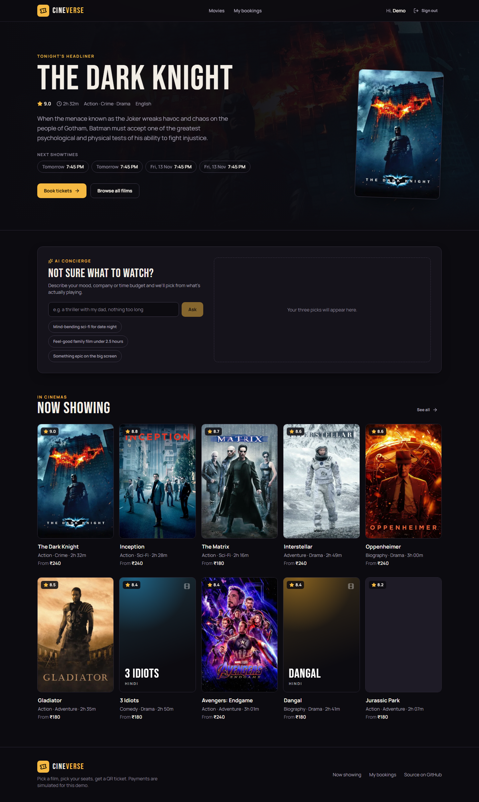
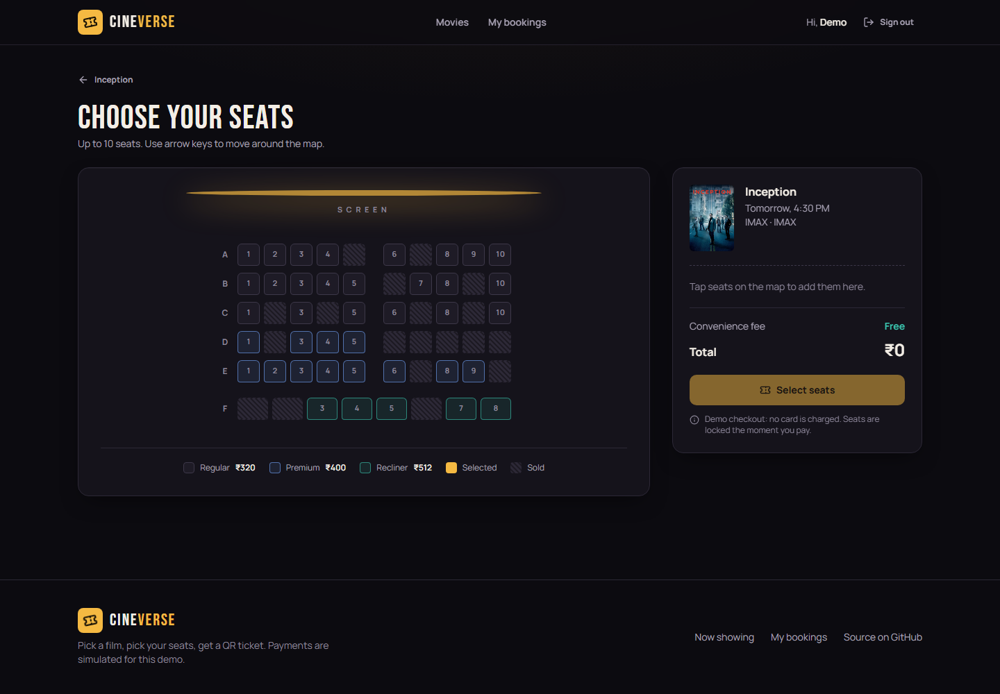
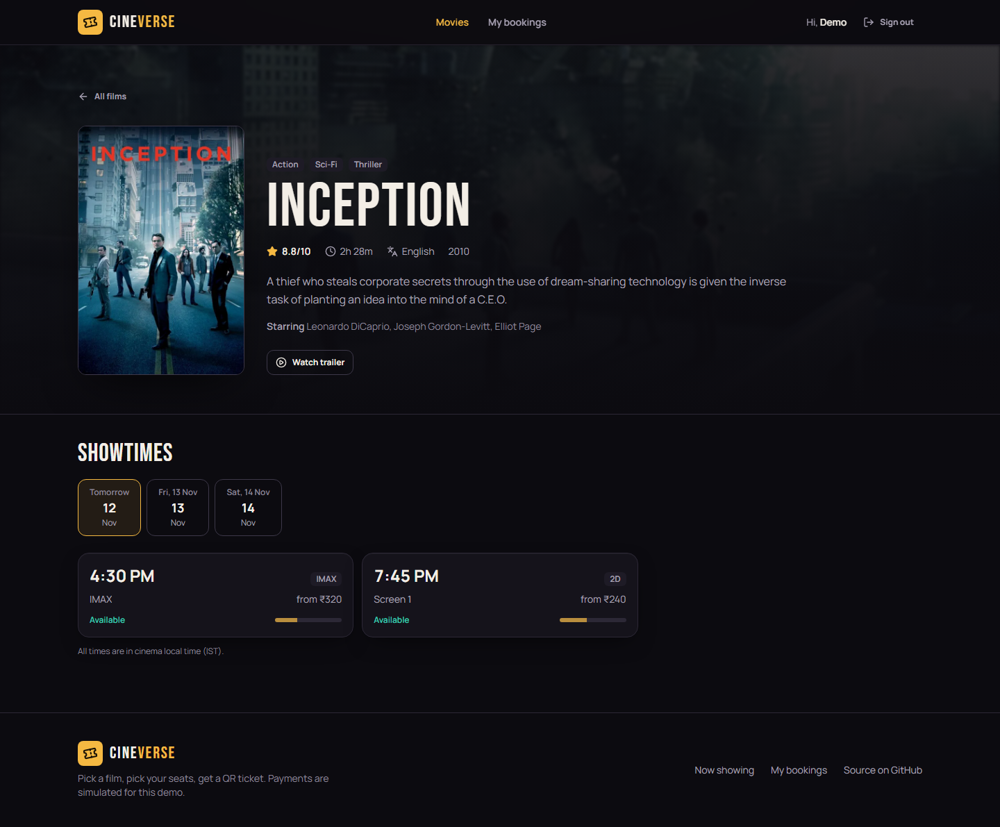
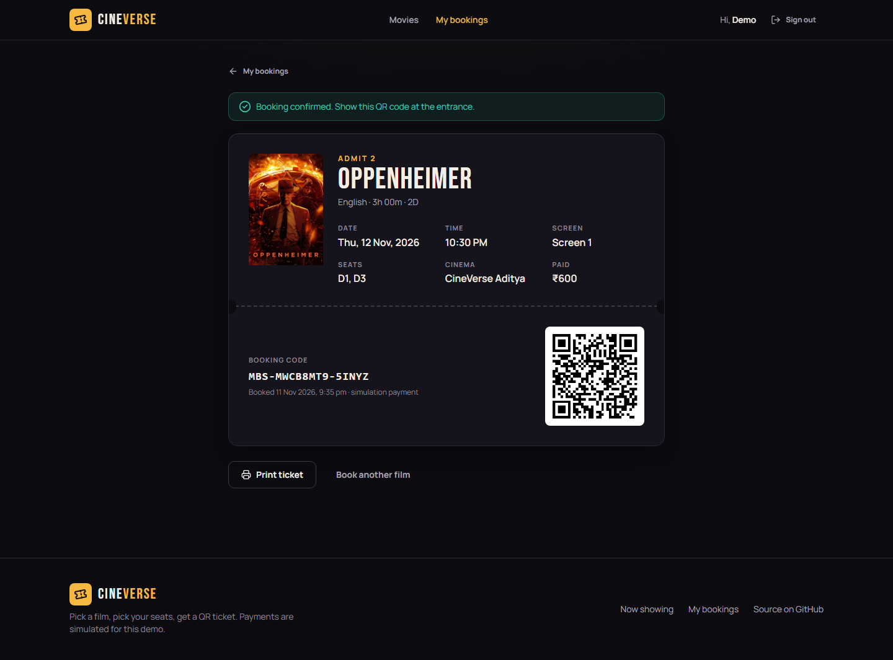
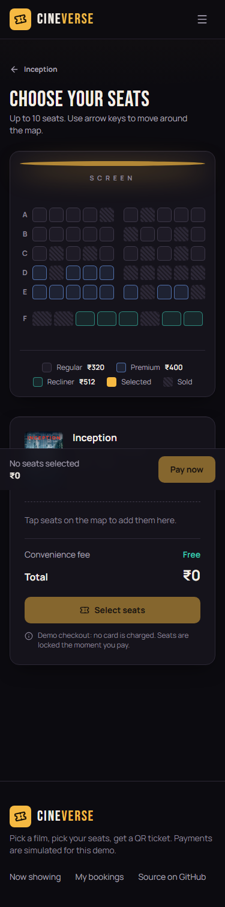
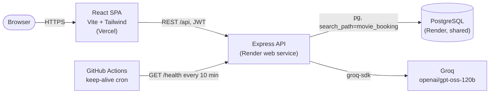

# CineVerse: Movie Ticket Booking

Pick a film, choose a showtime, grab exact seats on a live seat map, and walk in with a QR ticket. Double booking is prevented by row-locked Postgres transactions.

[](https://github.com/HarshBathija-04/Movie-booking-system/actions/workflows/ci.yml)

| | |
| --- | --- |
| **Live app** | `https://<your-app>.vercel.app` (Vercel) |
| **API** | `https://<your-api>.onrender.com/health` (Render) |
| **Demo login** | `demo@cineverse.app` / `demo1234`, or the "Continue with the demo account" button |

> The API runs on Render's free tier and sleeps when idle. The first request can take 30-60 s; the UI shows a "waking up the server" notice while it starts.

## Features

- **Now-showing catalog**: poster grid with search, genre and language filters, ratings, runtimes and "from" prices.
- **Showtimes by day**: a date picker plus showtime cards with format (2D / 3D / IMAX), price and live availability.
- **Interactive seat map**: Regular, Premium and Recliner tiers with server-computed tiered pricing. Sold seats are hatched. Full keyboard support (arrow keys, Space/Enter) and screen-reader labels.
- **Transaction-safe checkout**: seats are locked with `SELECT ... FOR UPDATE` inside one transaction, so when two buyers race for the same seat, exactly one wins and the other gets a clear "just booked by someone else" message. The map refreshes and the lost seats drop out of their selection.
- **My bookings wallet**: upcoming and past ticket stubs, each with a printable ticket and a QR code.
- **AI concierge (Groq)**: describe your mood ("a thriller with my dad, nothing too long") and get up to three picks, chosen only from films that actually have upcoming shows. Model output is validated against the catalog, so it cannot invent titles.
- **Admin console** (lazy-loaded): revenue and ticket stats, film CRUD with soft delete, showtime scheduling, and searchable bookings.
- **Production hygiene**: JWT auth with bcrypt hashing, zod validation on every endpoint, helmet, a CORS allow-list, rate limits on auth and AI, consistent JSON errors, `/health` with a DB check, and graceful shutdown.

## Screenshots

| Home | Seat map |
| --- | --- |
|  |  |
| **Film & showtimes** | **QR ticket** |
|  |  |

<p align="center"></p>

## Architecture



The booking critical section:

```mermaid
sequenceDiagram
  participant A as Buyer A
  participant B as Buyer B
  participant API
  participant DB as Postgres
  A->>API: POST /api/bookings {E4}
  B->>API: POST /api/bookings {E4}
  API->>DB: BEGIN; SELECT seats ... FOR UPDATE (A)
  API->>DB: BEGIN; SELECT seats ... FOR UPDATE (B) waits on A's row lock
  API->>DB: INSERT booking; UPDATE seats SET booking_id; COMMIT (A)
  DB-->>API: B's SELECT returns E4 already booked
  API-->>A: 201 Created
  API-->>B: 409 seats_taken {taken: [E4]}
```

## Tech stack

| Layer | Tech |
| --- | --- |
| Frontend | React 19, React Router 7, Vite 8, Tailwind CSS 4, axios, lucide-react, react-hot-toast |
| Backend | Node 22+, Express 5, pg, zod, helmet, express-rate-limit, jsonwebtoken, bcryptjs, qrcode, nodemailer (optional) |
| AI | Groq via `groq-sdk` (`openai/gpt-oss-120b`), called only from the backend |
| Data | PostgreSQL 16 with plain SQL migrations and an idempotent seed |
| Quality | Vitest + Supertest (including a concurrent double-booking test), ESLint, Prettier, GitHub Actions CI |
| Hosting | Vercel (web), Render web service (API), Render PostgreSQL |

## Local setup

Prerequisites: Node 22+ and a PostgreSQL database (Docker works fine).

```bash
# 1. Database (skip if you already have Postgres)
docker run -d --name cineverse-pg -e POSTGRES_PASSWORD=postgres -e POSTGRES_DB=portfolio -p 5433:5432 postgres:16-alpine

# 2. API (http://localhost:5126)
cd server
cp .env.example .env          # then fill in GROQ_API_KEY if you want the AI concierge
npm install
npm run db:migrate && npm run db:seed
npm run dev

# 3. Web (http://localhost:5213)
cd ../client
cp .env.example .env
npm install
npm run dev
```

Tests: `npm test` in `server/` (it needs the database; it uses an isolated `movie_booking_test` schema that it resets on each run) and in `client/`. Lint and format checks: `npm run lint` and `npm run format:check` in each package.

### Environment variables

**server/.env**

| Variable | Required | Description |
| --- | --- | --- |
| `DATABASE_URL` | yes | Postgres connection string |
| `DB_SCHEMA` | no (default `movie_booking`) | Schema that holds this app's tables in the shared database |
| `JWT_SECRET` | yes in production | Secret used to sign auth tokens |
| `FRONTEND_URL` | yes in production | Comma-separated list of allowed CORS origins, e.g. `https://cineverse.vercel.app` |
| `GROQ_API_KEY` | no | Enables the AI concierge; without it the endpoint returns a friendly 503 |
| `PORT` | no (default `5126`) | HTTP port (Render injects it) |
| `ADMIN_EMAIL`, `ADMIN_PASSWORD` | no | When both are set, the seed creates or updates an admin account |
| `SMTP_HOST`, `SMTP_PORT`, `SMTP_USER`, `SMTP_PASS`, `SENDER_EMAIL` | no | Booking confirmation emails |

**client/.env**

| Variable | Description |
| --- | --- |
| `VITE_API_URL` | API base URL including `/api`, e.g. `https://cineverse-api.onrender.com/api` |

## Deployment

1. **Database (once, shared).** Create a free Render PostgreSQL instance, or reuse the existing shared one, and copy its **Internal Database URL**. This app keeps all of its tables inside the `movie_booking` schema, so it can share the database with other projects.
2. **API on Render.** In Render, choose **New → Blueprint** and point it at this repo. `render.yaml` creates the `cineverse-api` web service (`rootDir: server`, health check `/health`, generated `JWT_SECRET`). When prompted, set:
   - `DATABASE_URL`: the shared database URL
   - `FRONTEND_URL`: your Vercel URL
   - `GROQ_API_KEY`: your Groq key (optional)
   - `ADMIN_EMAIL` / `ADMIN_PASSWORD`: optional staff login for the admin console

   Every boot runs the migrations and the idempotent seed. Both are no-ops when the data is up to date, and the seed keeps the demo schedule rolling four days ahead.
3. **Web on Vercel.** Import the repo, set **Root Directory** to `client`, and add `VITE_API_URL=https://<your-api>.onrender.com/api`. `vercel.json` handles SPA rewrites and cache headers.
4. **Keep-alive.** In GitHub, go to **Settings → Secrets and variables → Actions → Variables** and add `BACKEND_URL=https://<your-api>.onrender.com`. The `keep-alive` workflow then pings `/health` every 10 minutes. It skips cleanly while the variable is unset.

## API overview

| Method & path | Auth | Purpose |
| --- | --- | --- |
| `GET /health` | | Liveness plus a DB check: `{"status":"ok","db":"ok"}` (503 when the DB is down) |
| `POST /api/auth/register`, `POST /api/auth/login`, `GET /api/auth/me` | rate-limited / user | Accounts |
| `GET /api/movies?search=&genre=`, `GET /api/movies/:id` | | Catalog and upcoming showtimes |
| `GET /api/shows/:id` | | Show, seat map and tier prices |
| `POST /api/bookings`, `GET /api/bookings/mine`, `GET /api/bookings/mine/:id` | user | Book seats, wallet, ticket with QR |
| `POST /api/ai/recommend` | rate-limited | AI concierge picks |
| `POST/PUT/DELETE /api/movies`, `/api/shows`, `GET /api/admin/*` | admin | Back office |

Errors always look like `{ "success": false, "error": { "code": "seats_taken", "message": "...", "details": ... } }`.

## Project structure

```
.
├── client/                 React SPA (Vercel)
│   ├── public/             favicon, OG image
│   └── src/
│       ├── components/     AppShell, SeatGrid, MovieCard, Concierge, shared UI states
│       ├── pages/          Home, Movies, MovieDetails, SeatBooking, MyBookings, BookingDetails, Auth, admin/*
│       ├── hooks/          useFetch
│       ├── lib/            formatting helpers (+ tests)
│       └── services/       axios client with cold-start detection
├── server/                 Express API (Render)
│   ├── configs/            env + pg pool (search_path per schema)
│   ├── controllers/        auth, movies, shows, bookings (row-locked), admin, ai
│   ├── db/                 migrations/*.sql, migrate.js, seed.js, movies.json
│   ├── middleware/         auth, validation + error handling, rate limits
│   ├── routes/             zod-validated routers
│   ├── utils/              pricing, seat layout, SQL column maps, email
│   └── tests/              unit + API smoke tests (vitest + supertest)
├── diagrams/               original UML / DFD / ER diagrams
├── docs/screenshots/
├── render.yaml             Render Blueprint (API only; DB is shared)
└── .github/workflows/      ci.yml, keep-alive.yml
```

## Notes

- Payments are simulated; no card details are ever collected.
- Movie posters come from TMDB. Titles without a working poster get a generated typographic poster.
- Showtimes are stored as `timestamptz` and presented in cinema time (IST).

Built by [Harsh Bathija](https://github.com/HarshBathija-04).
